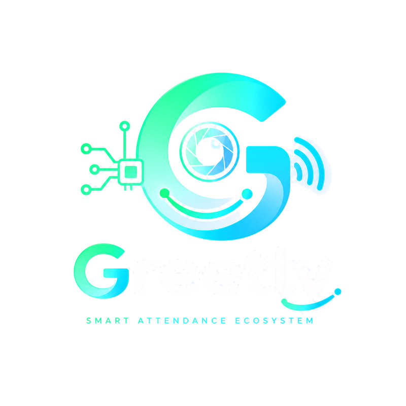

<div align="center">
  

  <br />
  
  <h1>Greetly</h1>
  <p><strong>Edge-to-Cloud IoT Attendance System with Facial Recognition & Realtime Dashboard</strong></p>

  <p>
    <a href="https://greetly.syahmiaof.my"></a>
    <a href="https://github.com/syahmiaof/greetly"></a>
    <a href="LICENSE"></a>
    <a href="https://syahmiaof.my"></a>
  </p>

  <p>
    
    
    
    
    
    
    
    
  </p>
</div>

---

## Overview

- **Functionality**: Connected IoT edge-to-cloud smart attendance system combining Raspberry Pi local camera facial recognition (OpenCV/LBPH) with Supabase PostgreSQL and a real-time Next.js live telemetry dashboard.
- **Aesthetic Value**: Minimalist hardware-software synergy featuring real-time attendance telemetry animations, responsive edge status indicators, and physical OLED display feedback.
- **Business Value**: Eliminates manual roster check-ins and credential fraud by running zero-contact edge recognition with built-in cooldowns, saving operational hours for classrooms and offices.

> **Active Student Project**: The repository documents the current implementation and its operational limits; it is not an independently validated biometric product or clinical benchmark.

---

## What It Connects

```text
Camera → Raspberry Pi → OpenCV/LBPH → Supabase/PostgreSQL → Next.js Realtime UI
```

- **Edge Computer Vision**: Camera frames and face matching execute locally on the Raspberry Pi edge node.
- **Debounced Attendance Logic**: A per-person cooldown timer suppresses repeated duplicate attendance records.
- **Cloud Ingestion**: Verified attendance events are dispatched through the Supabase client library.
- **Real-Time Telemetry**: The Next.js dashboard subscribes to database changes via Supabase Realtime WebSocket channels.
- **Physical Feedback Loop**: Integrated SSD1306 OLED display, status LEDs, and buzzer modules provide immediate user confirmation.

---

## Technical Scope & Authorship

**Muhammad Syahmi (syahmiaof)** architected and implemented:
- Designed and built the live web dashboard, real-time telemetry feeds, and edge pipeline scripts.
- Engineered data persistence contracts, WebSocket synchronization, and localized retry queues.
- Configured hardware feedback routines (OLED rendering, audio indicators, network heartbeat pulses).
- Implemented production deployment pipelines via Vercel Edge and Cloudflare DNS.

---

## Technology Stack

| Layer | Technology |
|---|---|
| **Edge Compute** | Raspberry Pi 3, Python, OpenCV (LBPH Face Recognizer) |
| **Hardware Feedback** | Camera Module, SSD1306 I2C OLED, Piezo Buzzer |
| **Data & Synchronization** | Supabase, PostgreSQL, Realtime WebSockets |
| **Frontend Interface** | Next.js 16, React 19, TypeScript, Tailwind CSS v4 |
| **Infrastructure & CI** | GitHub Actions, Vercel Edge Network, Cloudflare DNS, systemd Kiosk Service |

---

## Continuous Integration & Quality

Codebase stability and edge reliability are validated continuously:
- **Type Checking**: Strict TypeScript validation across the Next.js telemetry dashboard.
- **Automated CI**: GitHub Actions workflow (`.github/workflows/ci.yml`) validates linting and production builds on every push to `main`.
- **Edge Deployment Architecture**: Edge automation and maintenance routines are organized under `scripts/edge/`, with developer and database migration tools in `scripts/dev/`.

---

## Engineering Notes

- The edge implementation utilizes local OpenCV LBPH recognition; image frames remain completely on-device during recognition, streaming only verified attendance records to the cloud.
- Local queue and backoff retry logic mitigate intermittent network drops between the edge node and cloud databases.
- Full architectural case study and design decisions are cataloged at [syahmiaof.my/projects/greetly](https://syahmiaof.my/projects/greetly).

---

## License

Copyright (c) 2026 Muhammad Syahmi ([syahmiaof](https://syahmiaof.my)). All rights reserved.  
Proprietary source code created solely for demonstration and portfolio showcase purposes.
